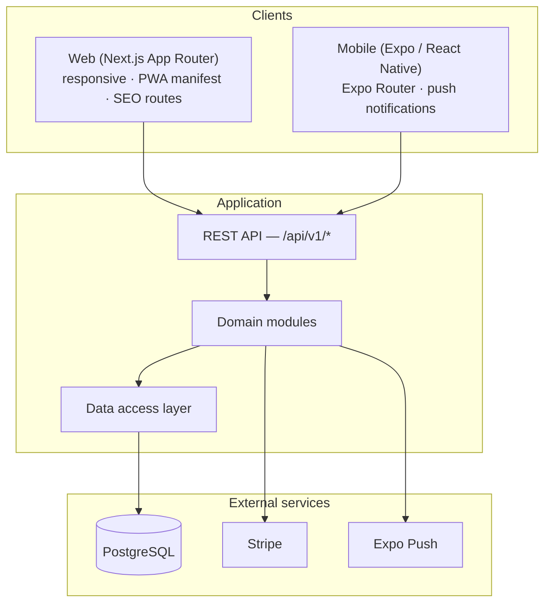
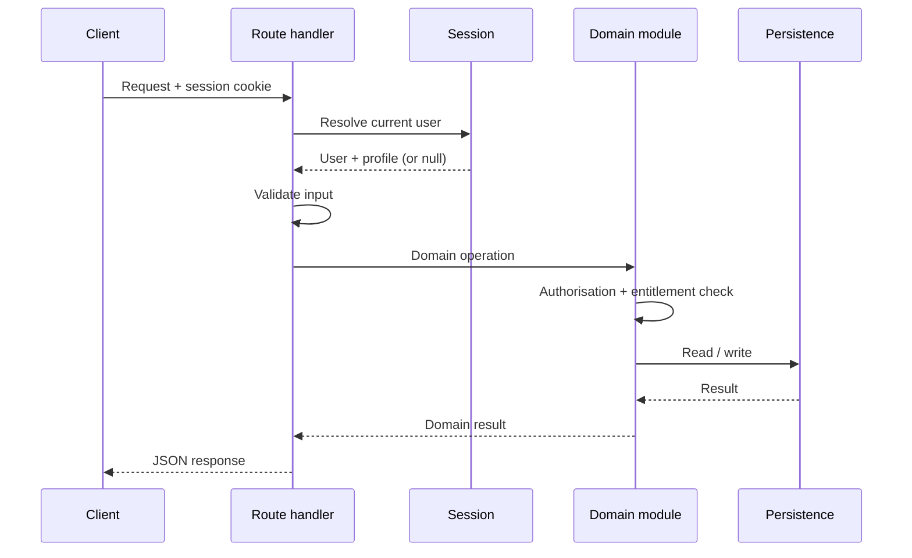
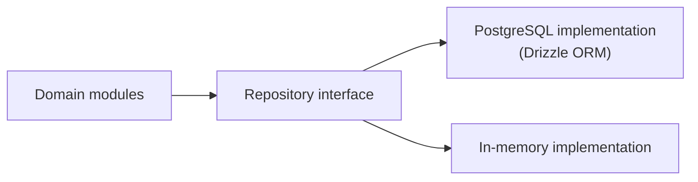
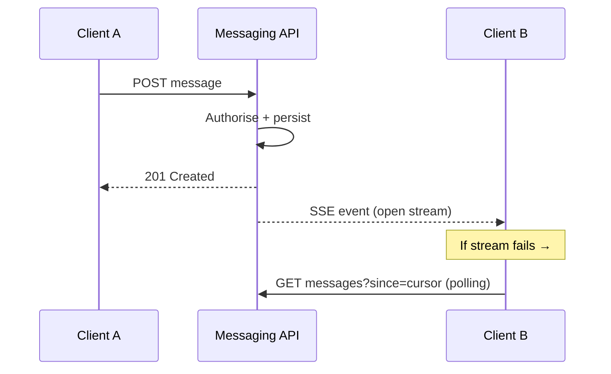
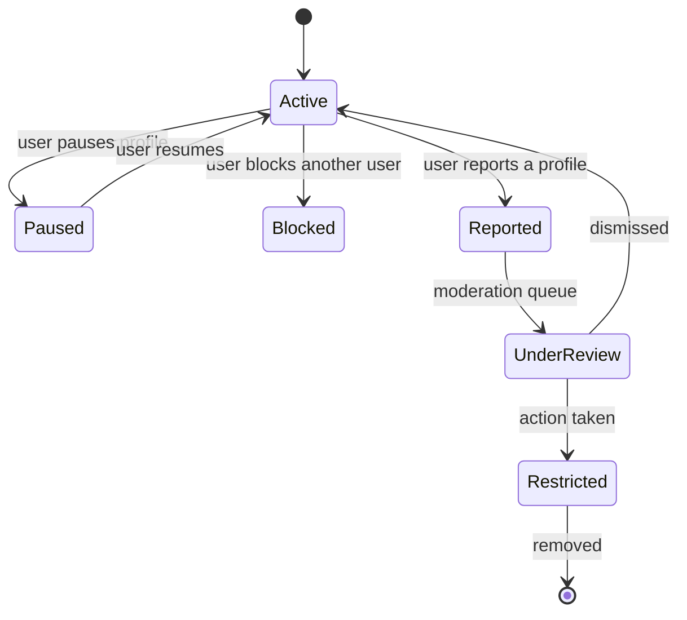
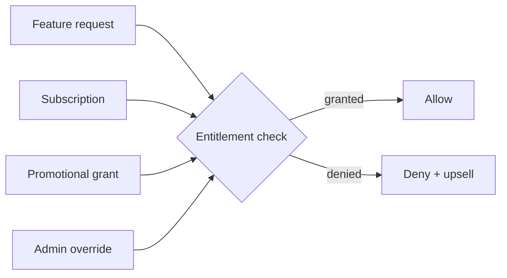
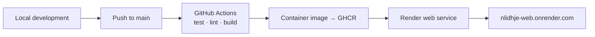

# Architecture

A high-level description of how N'Lidhje is put together. This document
describes structure and decisions, not proprietary implementation detail.

---

## System shape

N'Lidhje is a modular monolith with two clients.

### Why a modular monolith

The product is early. A distributed service topology at this stage would add
operational cost and failure modes without solving a real problem. Instead the
domain is split into clearly bounded modules inside one deployable:

- **identity** — accounts, sessions, age gating
- **discovery** — candidate generation, preferences, travel mode
- **matching** — likes, passes, mutual match creation, unmatching
- **messaging** — threads, message delivery, realtime transport
- **safety** — blocking, reporting, pausing, verification requests
- **entitlements** — plans, feature gating, promotions
- **billing** — checkout, webhooks, subscription state

Each module owns its own rules and is testable in isolation. When a module
genuinely needs independent scaling — messaging and realtime are the likely
candidates — it can be extracted without rewriting the domain logic, because
the boundaries already exist.

---

## Clients

### Web

Next.js App Router. Server components read session state and data directly,
which keeps the initial render fast and avoids a client-side data waterfall for
the common case. Interactive surfaces — the swipe deck, live chat, preference
forms — are client components layered on top.

The web client also serves as the PWA surface and owns the SEO-facing routes
(sitemap, robots, manifest), since those are meaningless in a native client.

### Mobile

Expo with Expo Router. The mobile client consumes the same `/api/v1` contract
as the web client. Sessions are stored in secure device storage, and push
notifications are registered against the same notification records the web
client reads — one notification model, two delivery channels.

---

## Request lifecycle

Two rules hold across every route:

1. **Authorisation is server-side and never inferred from the request body.**
   Identifiers supplied by a client are treated as input to be validated, not
   as proof of ownership.
2. **Entitlements are resolved centrally.** A route does not decide whether a
   user is premium; it asks the entitlement layer for a specific capability.

---

## Data layer

The domain talks to a repository interface, not to a database driver. Two
implementations exist:

- **PostgreSQL** — the production path, using Drizzle ORM with a typed schema
  covering users, profiles, likes, matches, messages, notifications, blocks,
  reports, subscriptions and push tokens.
- **In-memory** — used for local development and the public demo.

This is what allows the public demo to run with no database configured, and it
keeps the test suite fast: domain rules are tested without a database.

### Selected schema decisions

- **Likes are directional records**, and a match is created atomically when the
  reciprocal like exists — the match is derived from a real mutual action
  rather than created speculatively.
- **Blocks are directional and enforced on read.** Any query that could surface
  a blocked party filters on the block relation, rather than relying on each
  call site to remember.
- **Entitlements are time-boxed records**, so a promotional grant and a paid
  subscription are the same kind of thing with different provenance. Expiry is
  a property of the record, not a special case in feature code.

---

## Realtime messaging

Chat streams over Server-Sent Events. SSE was chosen over WebSockets because
the traffic is predominantly server-to-client and SSE survives the proxies and
mobile networks the product targets far more predictably than a persistent
bidirectional socket.

Because SSE still fails in some network conditions, the client treats the
stream as an optimisation rather than a requirement: if the stream drops or
never establishes, it falls back to cursor-based polling. Conversations keep
working; they are simply less immediate.

---

## Trust and safety

Safety is modelled as domain state, not UI state.

- **Blocking** takes effect on discovery, messaging and notifications at once,
  and is enforced server-side.
- **Reporting** produces a moderation record with a category and severity,
  surfaced in the Control Center queue.
- **Pausing** removes a profile from discovery without deleting data.
- **Age gating** is enforced when an account is created, from a date of birth,
  rather than being a client-side acknowledgement.

---

## Entitlements and monetisation

Every gated capability resolves through one check. Subscriptions and
promotional grants are both entitlement sources, so a launch promotion is
configuration rather than a code path. Plan contents and promotion eligibility
are server-controlled, which means pricing and packaging can change without
shipping a client release.

---

## Administration

The Control Center is part of the same application, separated by authorisation
rather than by deployment. It exposes platform metrics, feature flags,
moderation queues, verification requests and country availability.

Configuration is treated as data: enabling a country, flipping a feature flag or
adjusting a promotion is a persisted change with an audit trail, not a redeploy.

---

## Deployment

The image is built and published by CI, and the host pulls a prebuilt artifact.
Two consequences matter:

- **Reproducibility** — the deployed artifact is produced by a defined pipeline,
  not by hand on someone's machine.
- **Source privacy** — the host needs the image, not the source. The
  implementation can stay private while the application stays publicly
  reachable.

Production configuration is supplied entirely through environment variables.
The repository ships `.env.example` with placeholders; no secret is committed.

---

## Testing

- **52 unit tests** covering age gating, intent compatibility, entitlements,
  safety rules, notifications, push queueing, billing, travel mode, rate
  limiting and the in-memory store.
- **TypeScript strict mode** across the web application.
- **CI on every push** — lint, test and build.

The domain modules were written to be testable without a database, which is why
the suite runs in seconds rather than requiring a containerised Postgres.
