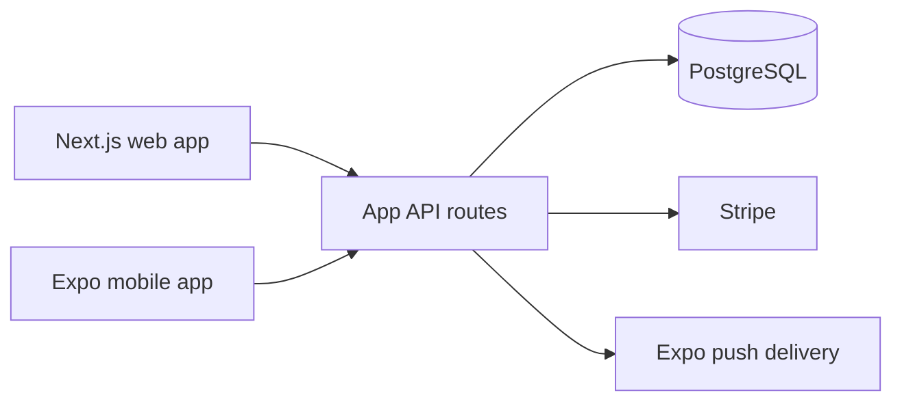

# N'Lidhje

> A Kosovo-first, global-ready dating platform for meaningful connections between adults 18+.

## Live Demo

Deployment is being provisioned. The verified production URL will be published here after the Vercel project is connected.

## Overview

N'Lidhje is a relationship-focused social platform designed around local cultural context, privacy, and deliberate discovery. The product combines a responsive web experience with a companion Expo mobile app.

## Product Highlights

- Profile discovery with intent and preference controls
- Likes, matches, and conversation flows
- Realtime chat with polling fallback
- Account, profile, notification, and safety controls
- Verification requests and subscription-ready billing flows
- Albanian-first localization with global-ready structure
- Responsive web experience and native mobile client

## Technology

- **Web:** Next.js, React, TypeScript, Tailwind CSS
- **Mobile:** Expo, React Native, Expo Router
- **Data:** PostgreSQL with Drizzle ORM, with a development fallback for local work
- **Payments:** Stripe integration points
- **Deployment:** Vercel for the web application; managed PostgreSQL for production data

## Architecture

The public repository is intentionally a portfolio presentation. Production source code, private infrastructure configuration, database credentials, and operational secrets remain private.

## Technical Highlights

- Monorepo structure shared by the web, mobile, and database packages
- Server-side session and authentication flows
- Safety primitives including blocking, reporting, pausing, unmatching, and account deletion
- Realtime messaging with graceful fallback when streaming is unavailable
- Production configuration designed to keep credentials in environment variables

## Project Status

Active development. The web application is the primary public demo surface; mobile builds are maintained separately for device distribution.

## Ownership

Built by **[ulasmango-cmd](https://github.com/ulasmango-cmd)**.

- GitHub profile: https://github.com/ulasmango-cmd
- Production source: private

## License

The implementation is proprietary. This repository contains portfolio documentation only; it does not grant rights to copy, modify, or redistribute the production source code or brand assets.
