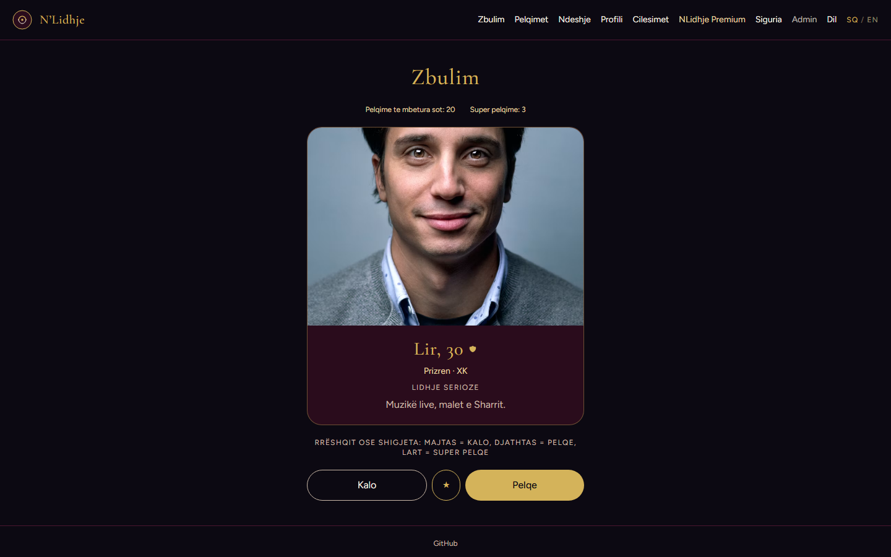
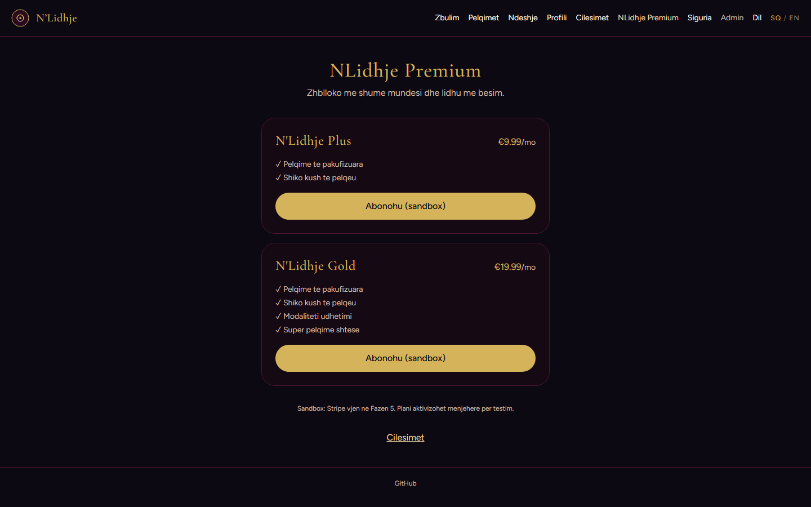
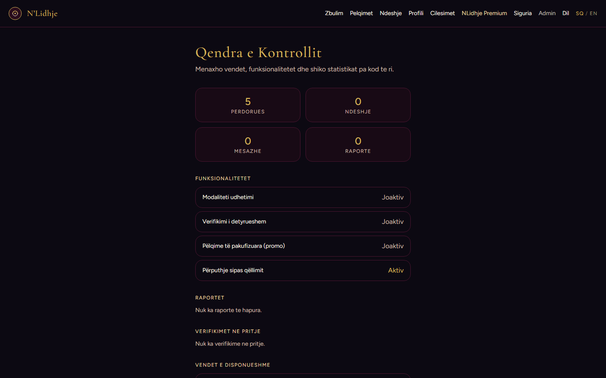
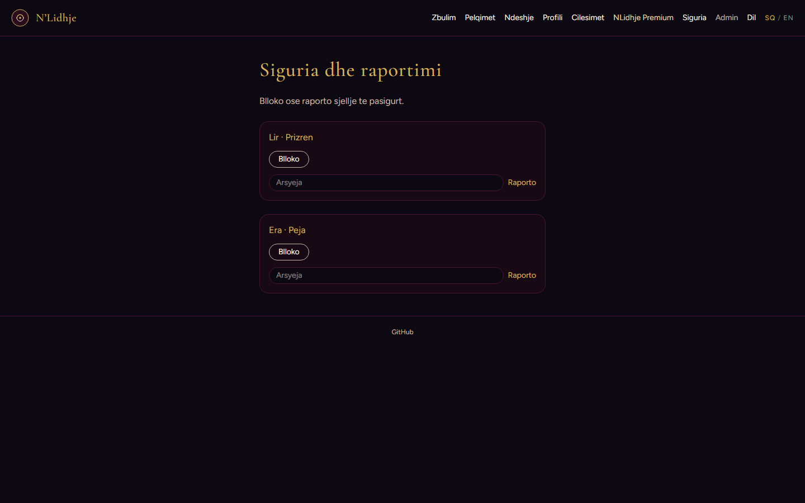
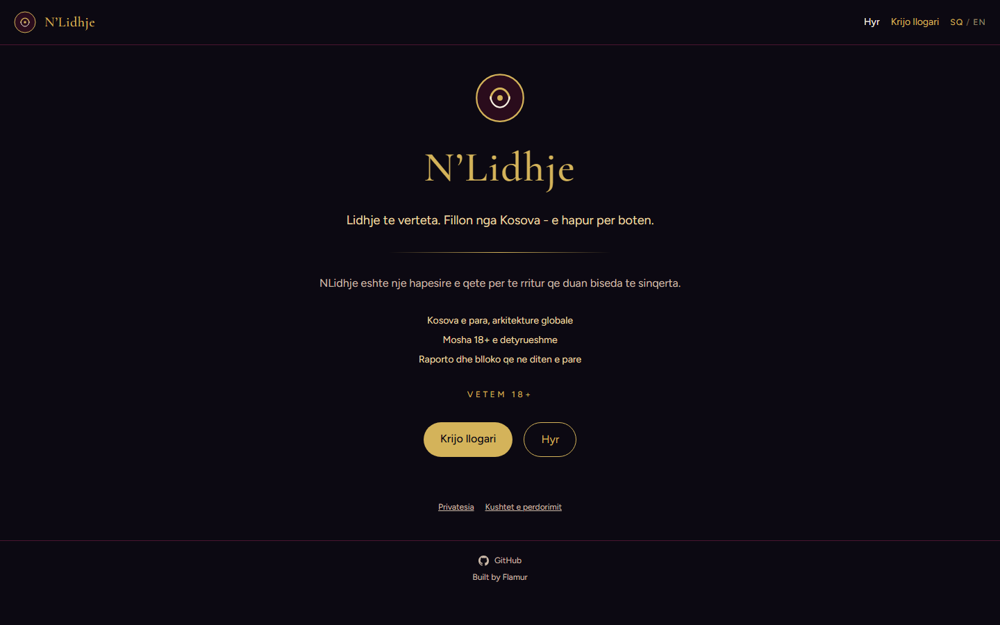
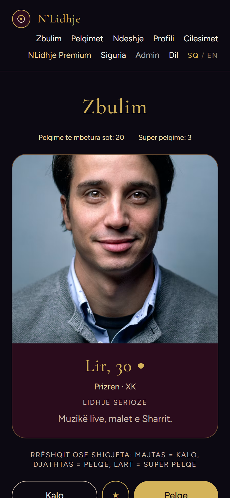
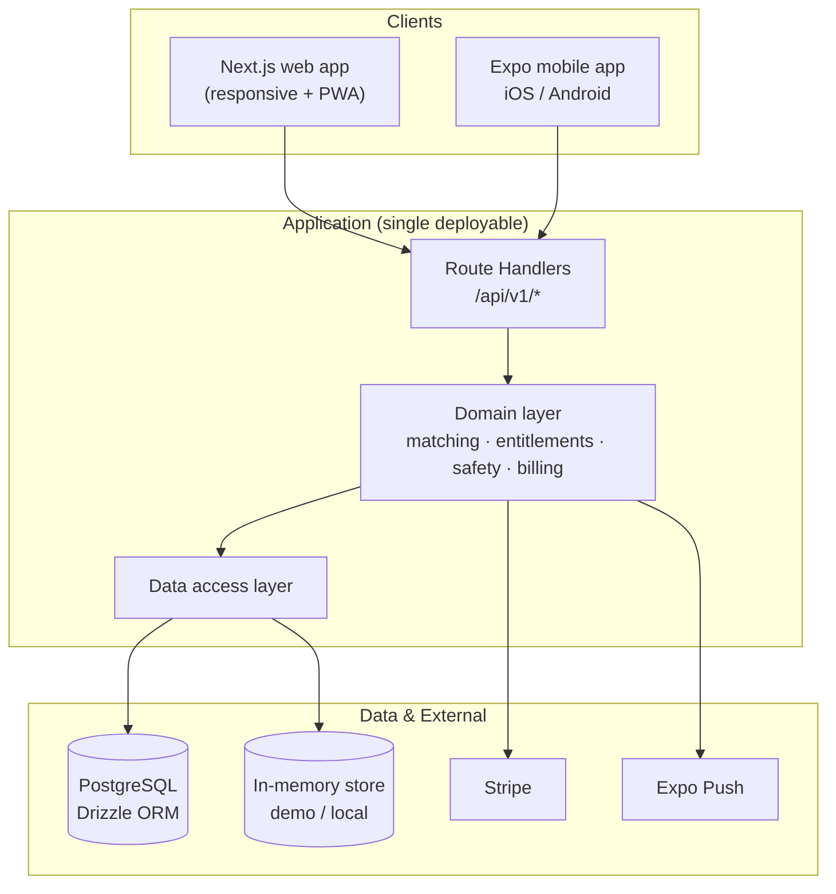

<div align="center">

# N'Lidhje

**A Kosovo-first, global-ready dating platform for adults 18+.**

Discover people by intent, not just proximity — with safety, verification and
privacy built into the foundation rather than bolted on afterwards.

[Live Demo](https://nlidhje-web.onrender.com) · [Architecture](ARCHITECTURE.md) · [Report an issue](https://github.com/ulasmango-cmd/nlidhje/issues)

</div>

---

## Live Demo

**https://nlidhje-web.onrender.com**

The demo runs on a free instance, so the first request after a period of
inactivity can take up to a minute to wake up. No sign-up is required to look
around — a seeded profile is available:

| Email | Password |
|---|---|
| `arina@example.com` | `nlidhje-demo` |

> The demo uses an in-memory data store, so it resets periodically. That is
> intentional: it keeps a public sandbox available without exposing production
> data or infrastructure.

---

## Screenshots

| Discovery deck | Premium plans |
|---|---|
|  |  |

| Control Center | Safety & reporting |
|---|---|
|  |  |

| Landing page | Mobile client |
|---|---|
|  |  |

---

## Overview

N'Lidhje (Albanian for *"connection"*) is a relationship-focused social
platform built around a specific observation: most dating products optimise for
volume of interactions, while the people using them are optimising for the
quality of a single one.

The product is designed to launch in Kosovo with Albanian as the primary
language, but the architecture was built for worldwide expansion from the first
commit — country availability, feature availability and monetisation are all
server-controlled rather than hardcoded.

This repository is a **portfolio presentation** of that product. It documents
what was built, how it is structured, and where it runs. The production source
code, infrastructure configuration and credentials are private.

---

## Features

**Discovery and matching**
- Swipe-based discovery deck with keyboard controls on desktop
- Intent-aware matching — users state what they are looking for, and
  incompatible intents are filtered out before a profile is ever shown
- Configurable discovery preferences (gender, looking for, intent)
- Travel mode for temporarily discovering a different city

**Conversations**
- Realtime chat over Server-Sent Events, with an automatic polling fallback
  when streaming is unavailable
- Icebreakers for empty conversations
- Unmatch, block and report from within a thread

**Trust and safety**
- Multi-level verification requests with a verified badge on profiles
- Blocking, reporting and profile pausing as first-class, persisted actions
- 18+ enforcement at the data layer, not just a checkbox
- Safety centre with reporting categories and a documented escalation path

**Account and privacy**
- Email/password authentication with server-side sessions
- Profile editing, photo handling and notification preferences
- Full account deletion
- Albanian and English localisation, with locale-aware formatting

**Monetisation**
- Original subscription tiers (N'Lidhje Plus, N'Lidhje Gold) rather than
  borrowed competitor branding
- Central entitlement engine — premium capabilities are gated by
  server-controlled entitlements instead of scattered `if premium` checks
- Stripe integration points and a configurable promotional entitlement system

**Operations**
- "Control Center" administration surface: platform metrics, feature flags,
  moderation reports, verification queue and country availability

---

## Technology

| Layer | Choice |
|---|---|
| **Web** | Next.js (App Router), React, TypeScript, Tailwind CSS |
| **Mobile** | Expo / React Native with Expo Router, shared API client |
| **API** | Next.js Route Handlers under `/api/v1` (modular monolith) |
| **Data** | PostgreSQL with Drizzle ORM; in-memory store for local/demo use |
| **Payments** | Stripe |
| **Notifications** | Expo Push |
| **Infrastructure** | Docker, GitHub Actions, GitHub Container Registry, Render |
| **Quality** | Vitest (52 unit tests), ESLint, TypeScript strict mode, GitHub Actions CI |

---

## Architecture



The web app and the API are a single deployable: the Next.js application serves
both the UI and the REST API. The mobile client consumes the same API, which
keeps the two platforms on one contract instead of two divergent backends.

The data access layer sits behind a narrow interface with two implementations —
PostgreSQL in production and an in-memory store for local development and the
public demo. That is why the demo can run with no database at all.

More detail, including the request lifecycle and the reasoning behind the
modular-monolith boundary, is in [ARCHITECTURE.md](ARCHITECTURE.md).

---

## Engineering highlights

**Intent-aware matching instead of pure distance ranking.**
Candidate generation filters on mutual intent compatibility before ranking, so
someone looking for a serious relationship is not served to someone looking for
something casual. The compatibility rules are isolated in a pure, unit-tested
module rather than spread through the query layer.

**Realtime that degrades instead of breaking.**
Chat streams over Server-Sent Events. Because SSE is unreliable on some mobile
networks and proxy configurations, the client detects stream failure and
transparently switches to interval polling — the conversation keeps working
rather than showing a spinner forever.

**One entitlement engine, not scattered premium checks.**
Every paid capability resolves through a central entitlement check driven by
server-side state. Adding or changing what a plan includes does not require
touching feature code, and promotional grants are modelled as time-boxed
entitlements rather than special cases.

**Safety primitives that persist.**
Blocking, reporting, pausing and unmatching are real persisted operations with
consistent effects on discovery, messaging and notifications — not UI-only
toggles. Blocking is enforced server-side on every read path that could expose
the blocked party.

**Cross-platform from one contract.**
Web and mobile share the API surface, types and validation. The mobile app was
built against the same versioned endpoints the web app uses, so a change to the
contract is a change for both clients at once.

---

## Security posture

Stated precisely, including what is not yet done — a security claim that
overstates the implementation is worse than no claim at all.

**In place**

- **18+ enforced server-side at three layers**, computed from the date of birth
  rather than a checkbox, and not disableable from the admin panel.
- **Passwords** hashed with `scrypt` and a per-user salt, compared in constant
  time. Sessions are an opaque server-validated cookie (`HttpOnly`,
  `SameSite=Lax`, `Secure` in production) — no client-readable token payload.
- **Authorisation enforced server-side on every route.** Client-supplied
  identifiers are treated as input, never as proof of ownership. Blocks are
  enforced on the read path, so a blocked party cannot reappear through
  discovery, matches or notifications.
- **Security headers** applied in middleware: a restrictive CSP
  (`frame-ancestors`, `object-src`, `base-uri`, `form-action`), HSTS,
  `nosniff`, `X-Frame-Options: DENY`, a referrer policy and a permissions
  policy. `x-powered-by` is disabled and API responses are `no-store`.
- **Parameterised queries only** through the ORM; no string-built SQL.
- **Secrets** are environment variables only — the repository tracks
  `.env.example` with placeholders and nothing else.

**Not yet in place**

- No MFA on the admin surface, and no immutable audit log for admin actions.
- Rate limiting is in-memory and therefore per-instance — it needs a shared
  store before the service scales horizontally.
- No media scanning pipeline for uploads, and no shared schema-validation layer
  at API boundaries.

---

## Deployment

The application ships as a single container image built in CI:

```
push to main
   ↓
GitHub Actions
   ↓ builds Dockerfile, publishes to GHCR
   ↓
Render web service pulls the image
   ↓
https://nlidhje-web.onrender.com
```

Keeping the image pipeline in CI rather than in the host means the deployed
artifact is reproducible and the application source never has to be published
to be deployed. The private production repository carries a `Dockerfile` and a
`render.yaml` blueprint, so the service can be reproduced on any container host.

**Production configuration**

- Secrets (`DATABASE_URL`, Stripe keys) are supplied as environment variables
  and are never committed.
- `.env.example` documents every supported variable with placeholder values.
- The public demo runs with no database configured, using the in-memory store.

---

## Project status

**Active development.** The web application is the primary public surface and
is functional end to end. The mobile client is maintained alongside it.

Known limitations, stated plainly:

- The public demo is stateless by design and resets periodically.
- Billing is not enabled in the demo — no payment provider keys are configured.
  The Stripe integration points exist in the code but are unexercised.
- Identity verification is a request/review workflow, not an integrated
  third-party KYC provider.

---

## Repository scope

This repository contains portfolio documentation only — screenshots,
architecture, and product description. It intentionally does **not** contain the
production implementation.

| | |
|---|---|
| **This repository** | Public portfolio presentation |
| **Production source** | Private (`ulasmango-cmd/nlidhje-source`) |
| **Live application** | https://nlidhje-web.onrender.com |

---

## Ownership

Built by **Flamur** — designed, engineered and deployed end to end, including
the data model, API surface, web client, mobile client, and the deployment
pipeline.

- GitHub: [@ulasmango-cmd](https://github.com/ulasmango-cmd)
- Location: Kosovo

---

## License

**Proprietary.** The N'Lidhje name, brand, design system and implementation are
the property of the author. This repository is provided for portfolio and
evaluation purposes only; it grants no rights to copy, modify, redistribute or
reuse the product, its brand assets or its implementation.

Third-party open-source dependencies remain under their respective licenses.
